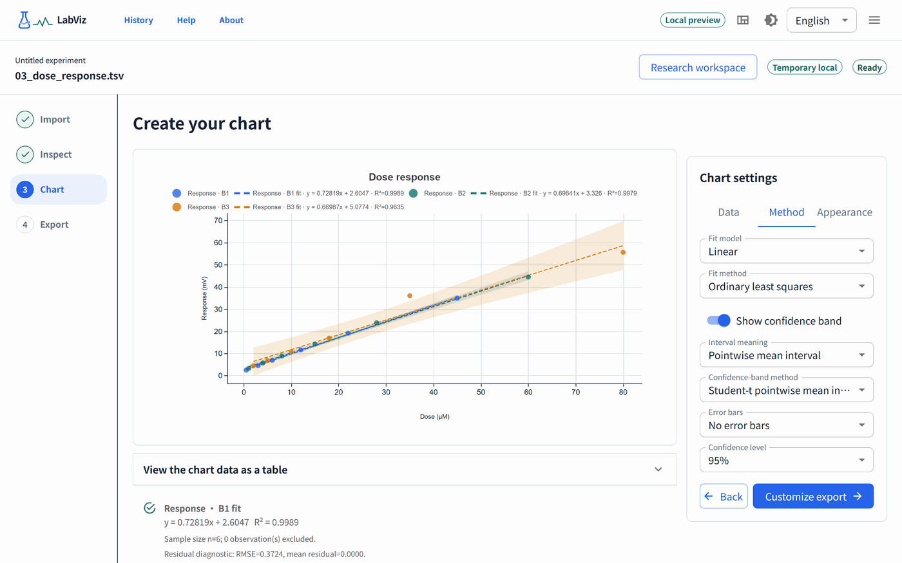
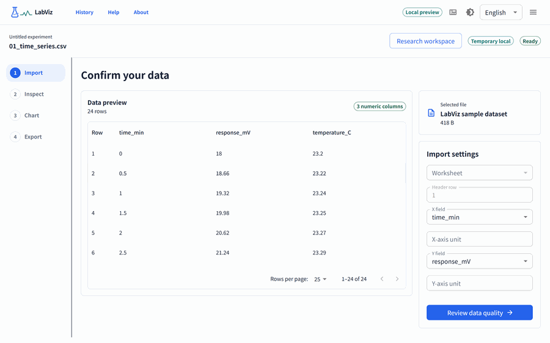
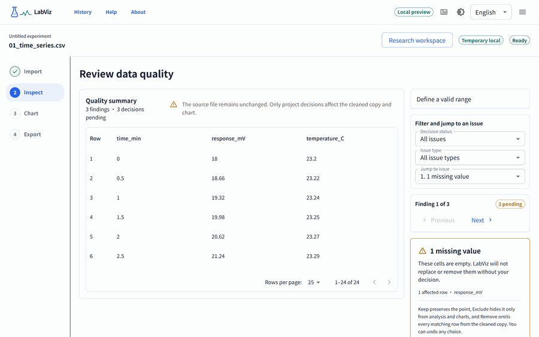
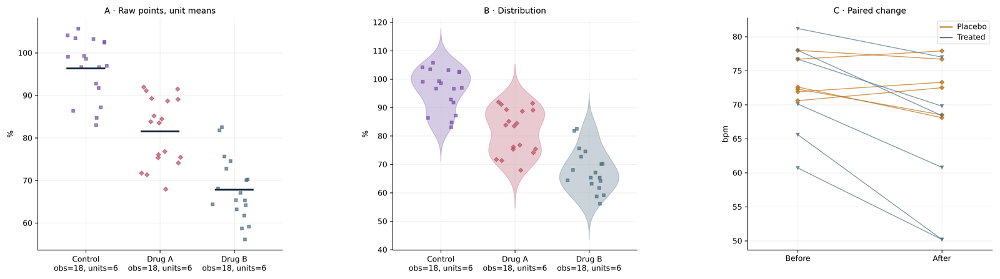
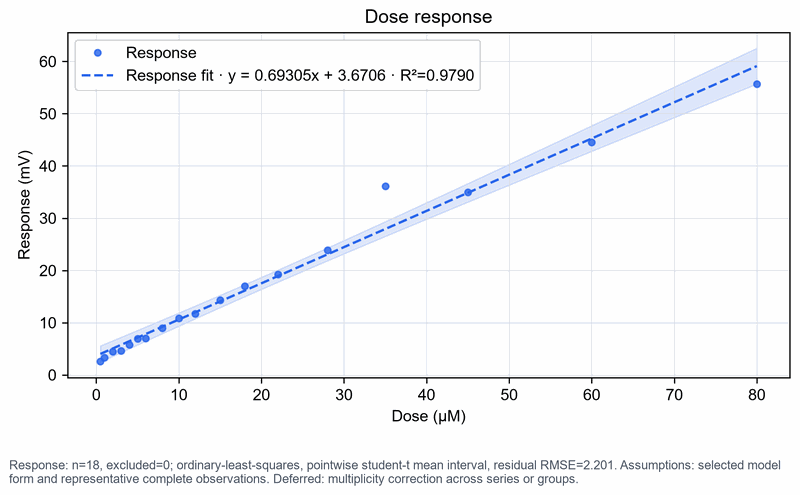
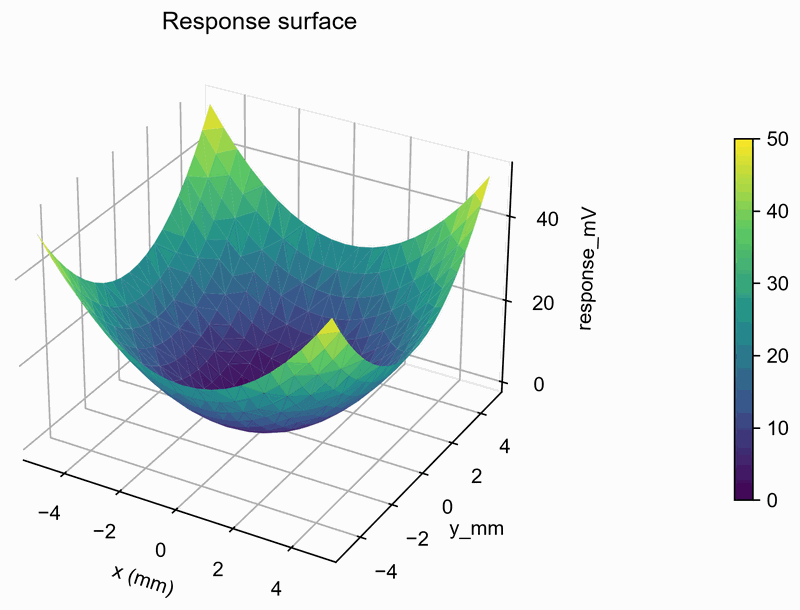
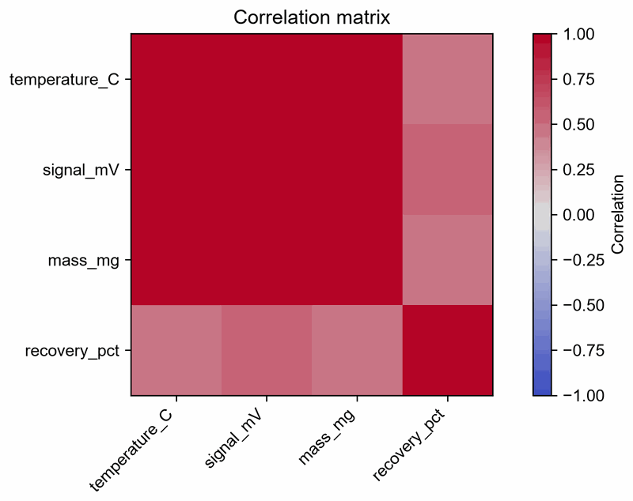

<div align="center">

<picture>
  <source media="(prefers-color-scheme: dark)" srcset="V2.0/assets/labviz-logo-dark.svg">
  
</picture>

# LabViz

**Messy lab table in, figure you can publish out. On your own computer.**

[](https://github.com/DDDYT24/lab-data-visualization-tool/actions/workflows/ci.yml)
[](https://github.com/DDDYT24/lab-data-visualization-tool/releases/latest)
[](https://github.com/DDDYT24/lab-data-visualization-tool/releases)
[](LICENSE)

[English](README.md) · [简体中文](README.zh-CN.md) · [Changelog](CHANGELOG.md) · [V2.4 notes](V2.0/RELEASE_NOTES_V2.4.md)

</div>

Hi, I'm LabViz. Hand me a CSV or Excel file and I read it before I draw anything. Missing values, duplicate rows and odd points get flagged, and you decide what stays. Then I turn what's left into figures you can put in a paper, and I can show you which rows made each point.

<p align="center">
  
</p>

## How a figure happens

<table>
  <tr>
    <td width="50%"></td>
    <td width="50%"></td>
  </tr>
  <tr>
    <td><b>1. Show me the file.</b> I preview it before importing anything, so a wrong header row is caught in seconds.</td>
    <td><b>2. I point out the odd bits.</b> Missing cells, duplicates, type clashes and outliers. I flag them. I don't quietly delete them.</td>
  </tr>
</table>

**3. Pick a chart, tune it, export it.** Data, method and appearance each have their own tab. The window and the exported PNG, SVG or PDF draw from the same plan, so the preview and the file agree down to the tick marks.

## Things I drew

Every figure below is a real export, made by LabViz from synthetic data.

<p align="center">
  
</p>
<p align="center"><sub><b>A</b> raw points, not just bars · <b>B</b> distributions with every point · <b>C</b> paired change per subject</sub></p>

<table>
  <tr>
    <td></td>
    <td></td>
    <td></td>
  </tr>
  <tr>
    <td align="center">Fits that show their equation</td>
    <td align="center">3D surfaces</td>
    <td align="center">Correlation matrices</td>
  </tr>
</table>

See the small print under the research charts? That's me keeping count: observations, independent units, exclusions. Three repeat measurements of one mouse are still one mouse, so your n stays honest.

## What I do

- **Read** CSV, TSV, TXT, JSON and XLSX, and show a preview before importing.
- **Check** for missing values, duplicates, type conflicts and outliers. Every exclusion keeps its reason, and you can undo it.
- **Draw** line, scatter, bar, histogram, box, heatmap and 3D surface charts, plus grouped raw points, paired change and violin plots for research data.
- **Compose** figures of up to six panels in a grid or a mosaic, with log axes, manual ranges and ticks, and annotations.
- **Export** PNG, SVG and PDF, with text that stays text and the font you choose, and freeze a figure together with each panel's source data, parameters and revision history.

Everything runs locally. No account, database server or online service is needed.

## Install (Windows)

Download the setup file and `SHA256SUMS.txt` from [Releases](https://github.com/DDDYT24/lab-data-visualization-tool/releases) and check the hash first:

```powershell
Get-FileHash .\LabViz-Desktop-2.4.0-Private-Setup.exe -Algorithm SHA256
```

I bring my own Python, Node.js, scientific libraries and fonts, and open in my own window. Start **LabViz Desktop Preview** from the Start menu. Closing the window saves a checkpoint, and the next start returns to the same workspace. Uninstalling keeps your data.

V2.4.0 upgrades your data to a format V2.3.0 cannot open. Installing over V2.3.0 keeps a snapshot from before the upgrade, and the [V2.4 notes](V2.0/RELEASE_NOTES_V2.4.md) give the steps back to V2.3.0.

See [install, backup and recovery](V2.0/docs/INSTALL_V2.3.md).

## Run from source

You need Git, Python 3.12 or 3.13, and Node.js 22.22.2 or later (packaging uses 24.22.0).

```powershell
git clone https://github.com/DDDYT24/lab-data-visualization-tool.git
Set-Location -LiteralPath .\lab-data-visualization-tool
git checkout v2.3.0
.\start-labviz.cmd
```

Source mode uses ports 3001 and 8001 and keeps data in `V2.0/api/.labviz/v23-development`.

## What I can't promise yet

- Code signing. Windows will warn you; keep its protection on rather than working around it.
- Acceptance on a clean machine, a fully disconnected workflow, and screen-reader use.
- One open advisory in `picomatch` has no fixed release yet. It reaches only an unused part of one production package and development tools that I don't ship; see the [dependency review](V2.0/docs/DEPENDENCY_SECURITY_REVIEW.md).

Whether a figure of mine is ready for a journal depends on you checking its size, fonts, statistical assumptions and caption. I don't judge whether the experiment itself is sound.

## Feedback and license

Report problems in [Issues](https://github.com/DDDYT24/lab-data-visualization-tool/issues), with synthetic data and no personal details in attachments. My source is MIT-licensed; bundled third-party components keep their own licenses, listed in [third-party notices](THIRD_PARTY_NOTICES.md).
