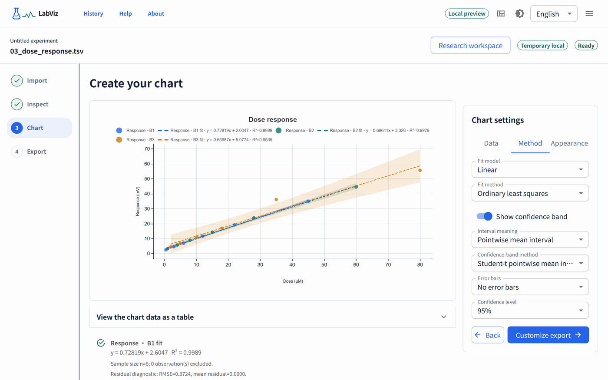
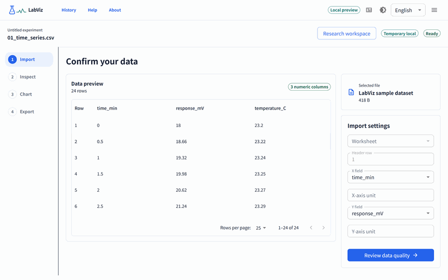
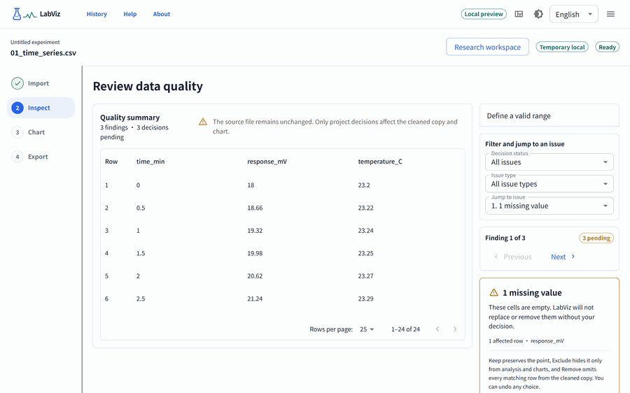
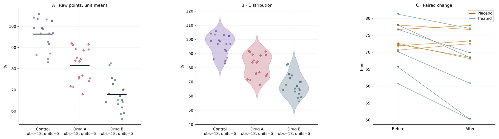
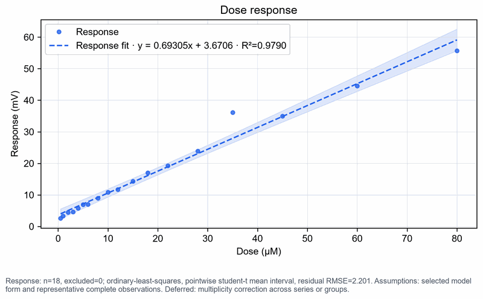
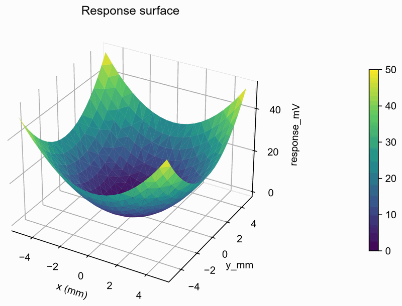
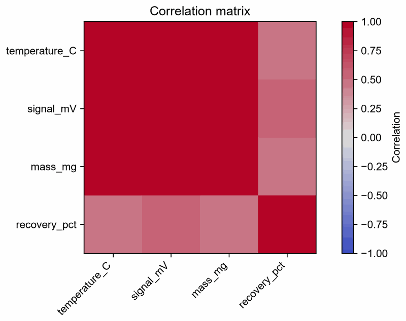

<div align="center">

<picture>
  <source media="(prefers-color-scheme: dark)" srcset="V2.0/assets/labviz-logo-dark.svg">
  
</picture>

# LabViz

**乱糟糟的实验表格进来，能投稿的图出去。全程在你自己的电脑上。**

[](https://github.com/DDDYT24/lab-data-visualization-tool/actions/workflows/ci.yml)
[](https://github.com/DDDYT24/lab-data-visualization-tool/releases/latest)
[](https://github.com/DDDYT24/lab-data-visualization-tool/releases)
[](LICENSE)

[English](README.md) · [简体中文](README.zh-CN.md) · [更新记录](CHANGELOG.md) · [V2.4 预览版说明](V2.0/RELEASE_NOTES_V2.4.md)

</div>

你好，我是 LabViz。把 CSV 或 Excel 交给我，我会先读一遍再动笔：缺失值、重复行、可疑的点都会标出来，留不留由你决定。然后我把剩下的数据画成能放进论文的图，图上每个点来自哪一行，我都能指给你看。

<p align="center">
  
</p>

## 一张图是怎么来的

<table>
  <tr>
    <td width="50%"></td>
    <td width="50%"></td>
  </tr>
  <tr>
    <td><b>1. 先给我看看文件。</b>导入前我先预览，表头行选错了几秒钟就能发现。</td>
    <td><b>2. 我把可疑的地方指出来。</b>空单元格、重复行、类型冲突、异常点。我只标记，不会偷偷删掉。</td>
  </tr>
</table>

<b>3. 选图、调整、导出。</b>数据、方法、外观各占一个标签页。窗口里的预览和导出的 PNG、SVG、PDF 画的是同一份作图计划，连刻度都对得上。

## 我画过的图

下面每一张都是 LabViz 用合成数据真实导出的。

<p align="center">
  
</p>
<p align="center"><sub><b>A</b> 画原始点，不只画柱子 · <b>B</b> 分布和每一个点 · <b>C</b> 每位受试者的配对变化</sub></p>

<table>
  <tr>
    <td></td>
    <td></td>
    <td></td>
  </tr>
  <tr>
    <td align="center">拟合方程直接写在图上</td>
    <td align="center">3D 曲面</td>
    <td align="center">相关矩阵</td>
  </tr>
</table>

注意到研究图下面那行小字了吗？那是我在记账：观测数、独立单元数、排除了几个。同一只小鼠测三次还是一只小鼠，你的 n 不会被悄悄放大。

## 我能做什么

- **读取** CSV、TSV、TXT、JSON、XLSX，导入前先给你看预览。
- **检查**缺失、重复、类型冲突和异常值。每一次排除都记下理由，也都能撤销。
- **作图**：折线、散点、柱状、直方、箱线、热图和 3D 曲面，研究数据还有分组原始点、配对变化和小提琴图。
- **拼组图**：最多六个面板，网格或自由拼版，支持对数坐标、手动范围和刻度、标注（V2.4 预览版）。
- **导出** PNG、SVG、PDF，还能把图和各面板的源数据、参数、修订记录一起冻结。

所有处理都在本机完成，不需要账号、数据库服务器或在线服务。

## 安装（Windows）

从 [Releases](https://github.com/DDDYT24/lab-data-visualization-tool/releases) 下载安装程序和 `SHA256SUMS.txt`，先核对哈希：

```powershell
Get-FileHash .\LabViz-Desktop-2.3.0-desktop.1-Private-Setup.exe -Algorithm SHA256
```

我自带 Python、Node.js、科研依赖和字体，在自己的窗口里运行。从开始菜单打开 **LabViz Desktop Preview**。关闭窗口时我会保存检查点，下次打开回到同一个工作区。卸载时默认保留你的资料。

- **V2.3.0** 是稳定版。
- **V2.4.0-rc.1** 是下一个预览版。它会把资料升级成 V2.3.0 打不开的格式；安装时会保留升级前的快照，退回 V2.3.0 的步骤见 [V2.4 预览版说明](V2.0/RELEASE_NOTES_V2.4.md)。

详见[安装、备份与恢复](V2.0/docs/INSTALL_V2.3.md)。

## 从源码运行

需要 Git、Python 3.12 或 3.13，以及 Node.js 22.22.2 以上（打包使用 24.22.0）。

```powershell
git clone https://github.com/DDDYT24/lab-data-visualization-tool.git
Set-Location -LiteralPath .\lab-data-visualization-tool
git checkout v2.3.0
.\start-labviz.cmd
```

源码模式使用 3001／8001 端口，数据存放在 `V2.0/api/.labviz/v23-development`。

## 我还没做到的

- 代码签名。Windows 会提示风险；请保留安全防护，不要绕过。
- 干净机器、完整物理断网和读屏使用的验收。
- `picomatch` 有一项公开告警，目前还没有修复版本。它只涉及一个生产依赖里没用到的部分，以及不随安装包发布的开发工具，详见[依赖审查](V2.0/docs/DEPENDENCY_SECURITY_REVIEW.md)。

我导出的图能否投稿，取决于你是否核对过尺寸、字体、统计假设和图注。实验设计是否成立，我不替你下结论。

## 反馈与许可

问题请提到 [Issues](https://github.com/DDDYT24/lab-data-visualization-tool/issues)，附件请使用合成数据并去掉个人信息。我的源码采用 MIT 许可，随包的第三方组件保留各自许可，见[第三方声明](THIRD_PARTY_NOTICES.md)。
